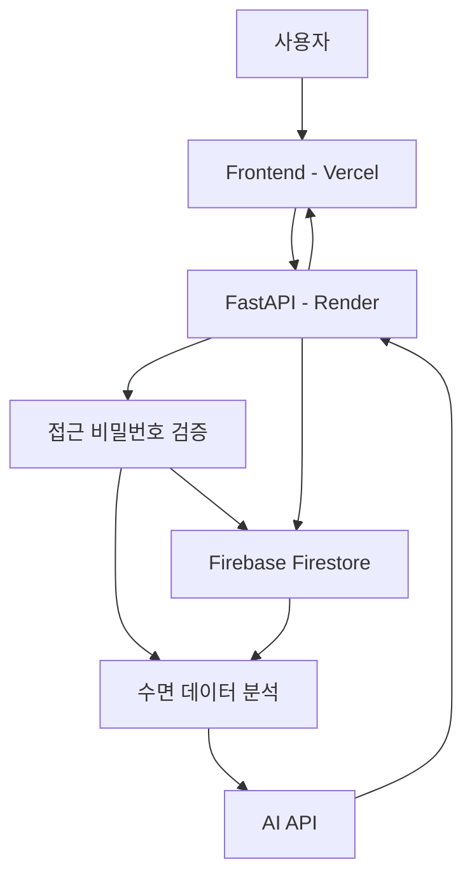
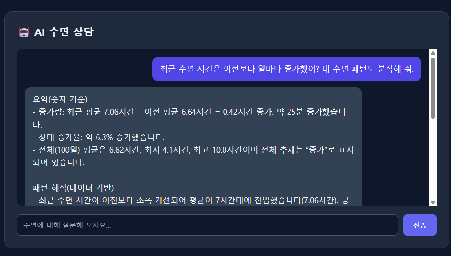
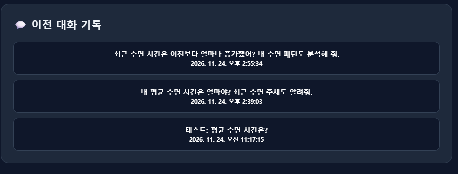

# 🌙 Sleep AI

## 1. 프로젝트 소개

Sleep AI는 수면 기록 데이터를 기반으로 사용자의 수면 패턴을 분석하고,
AI 챗봇을 통해 수면 통계 및 개선 방향을 안내하는 웹 서비스입니다.

Firebase Firestore에 저장된 수면 데이터를 FastAPI 서버에서 분석하고,
분석 결과를 AI 모델에 전달하여 실제 데이터에 근거한 답변을 생성합니다.

본 프로젝트는 교육용 프로젝트이며, 가상의 수면 데이터 100개를 사용합니다.

## 2. 배포 주소

- 웹사이트: https://my-ai-chatbot-frontend-eight.vercel.app
- 백엔드: https://sleep-ai-backend.onrender.com
- API 문서: https://sleep-ai-backend.onrender.com/docs
- GitHub: https://github.com/jmyd051027/my-ai-chatbot

## 3. 주요 기능

- 서비스 접근 비밀번호 인증
- 수면 데이터 등록, 조회, 수정, 삭제(CRUD)
- 100개의 시계열 수면 데이터 관리
- 전체 데이터 개수 및 분석 기간 확인
- 평균, 최소, 최대 수면 시간 분석
- 최근 수면 시간 변화 및 추세 분석
- 수면 통계 기반 AI 챗봇
- 질문 및 AI 답변 자동 저장
- 이전 대화 기록 조회 및 불러오기

## 4. 기술 스택

| 구분 | 사용 기술 |
| --- | --- |
| Frontend | HTML, CSS, JavaScript |
| Backend | Python, FastAPI |
| Database | Firebase Firestore |
| AI | OpenAI SDK, Codyssey OpenAI 호환 API |
| 데이터 검증 | Pydantic |
| 환경변수 관리 | python-dotenv |
| 버전 관리 | Git, GitHub |
| 백엔드 배포 | Render |
| 프론트엔드 배포 | Vercel |

## 5. 시스템 구조



사용자가 질문을 입력하면 백엔드는 Firebase에 저장된 수면 데이터를
조회하고 통계 정보를 생성합니다.

생성된 통계와 사용자 질문을 AI API에 전달하여 답변을 생성하고,
질문과 답변을 Firestore에 자동 저장합니다.

## 6. 프로젝트 폴더 구조

```text
my-ai-chatbot/
├── frontend/
│   ├── index.html
│   ├── style.css
│   └── app.js
├── routers/
│   ├── data_router.py
│   └── chat_router.py
├── schemas/
│   ├── data.py
│   └── chat.py
├── services/
│   ├── data_service.py
│   ├── summary_service.py
│   ├── chat_service.py
│   └── conversation_service.py
├── security/
│   └── auth.py
├── scripts/
│   └── seed_data.py
├── database.py
├── main.py
├── requirements.txt
├── .env.example
├── .gitignore
└── README.md
```

## 7. 데이터베이스 구조

### data 컬렉션

수면 기록 데이터를 저장합니다.

| 필드 | 자료형 | 설명 |
| --- | --- | --- |
| date | String | 수면 기록 날짜 |
| value | Number | 수면 시간 |
| memo | String | 수면 상태 메모 |

### conversations 컬렉션

사용자의 질문과 AI 답변을 저장합니다.

| 필드 | 자료형 | 설명 |
| --- | --- | --- |
| question | String | 사용자 질문 |
| answer | String | AI 답변 |
| created_at | String | 대화 생성 시간 |

각 데이터는 Firestore 문서 ID로 구분합니다.

## 8. API 명세

| Method | Endpoint | 설명 |
| --- | --- | --- |
| GET | / | 서버 상태 확인 |
| POST | /api/data | 수면 기록 등록 |
| GET | /api/data | 전체 수면 기록 조회 |
| PUT | /api/data/{data_id} | 수면 기록 수정 |
| DELETE | /api/data/{data_id} | 수면 기록 삭제 |
| GET | /api/data/summary | 수면 통계 및 추세 조회 |
| POST | /api/chat | AI 질문 및 답변 저장 |
| GET | /api/conversations | 이전 대화 목록 조회 |
| GET | /api/conversations/{conversation_id} | 특정 대화 조회 |

모든 /api 경로에는 X-Access-Key 헤더를 통한 접근 인증이 필요합니다.

## 9. 환경변수 설정

프로젝트 최상위 경로에 .env 파일을 생성합니다.

```env
OPENAI_API_KEY=
OPENAI_BASE_URL=https://copa.codyssey.kr/v1
OPENAI_MODEL=gpt-5-mini

FIREBASE_SERVICE_ACCOUNT_PATH=firebase-key.json
FIREBASE_SERVICE_ACCOUNT_JSON=

API_BASE_URL=http://127.0.0.1:8000
ALLOWED_ORIGINS=http://localhost:5500,http://127.0.0.1:5500

APP_ACCESS_KEY=
```

| 환경변수 | 설명 |
| --- | --- |
| OPENAI_API_KEY | AI API 인증 키 |
| OPENAI_BASE_URL | AI API 서버 주소 |
| OPENAI_MODEL | 사용할 AI 모델 |
| FIREBASE_SERVICE_ACCOUNT_PATH | 로컬 Firebase 인증 파일 경로 |
| FIREBASE_SERVICE_ACCOUNT_JSON | 배포용 Firebase 인증 JSON |
| API_BASE_URL | 백엔드 주소 설정 참고값 |
| ALLOWED_ORIGINS | 접속을 허용할 프론트엔드 주소 |
| APP_ACCESS_KEY | 서비스 접근 비밀번호 |

Firebase 인증 파일은 로컬 환경에서 사용하며,
Render 배포 환경에서는 Firebase 인증 JSON을 환경변수로 등록합니다.

실제 API 키와 인증 정보는 GitHub에 업로드하지 않습니다.

## 10. 로컬 실행 방법

### 저장소 다운로드

```bash
git clone https://github.com/jmyd051027/my-ai-chatbot.git
cd my-ai-chatbot
```

### 가상환경 생성 및 활성화 (Windows)

```powershell
python -m venv .venv
.\.venv\Scripts\Activate.ps1
```

### 라이브러리 설치

```bash
pip install -r requirements.txt
```

### 환경변수 설정

.env.example을 참고하여 .env 파일을 생성하고,
AI API 키, Firebase 인증 정보, 접근 비밀번호를 설정합니다.

### 백엔드 실행

```bash
python -m uvicorn main:app --reload
```

API 문서 접속:

http://127.0.0.1:8000/docs

### 프론트엔드 실행

로컬 백엔드를 사용하려면 frontend/app.js의 API_BASE_URL을
http://127.0.0.1:8000 으로 변경합니다.

새로운 터미널에서 다음 명령어를 실행합니다.

```bash
python -m http.server 5500 --directory frontend
```

브라우저에서 다음 주소로 접속합니다.

http://127.0.0.1:5500

## 11. 수면 데이터 분석 결과

| 분석 항목 | 결과 |
| --- | --- |
| 전체 수면 기록 | 100개 |
| 분석 시작일 | 2026-08-17 |
| 분석 종료일 | 2026-11-24 |
| 평균 수면 시간 | 6.62시간 |
| 최소 수면 시간 | 4.1시간 |
| 최대 수면 시간 | 10시간 |
| 이전 평균 | 6.64시간 |
| 최근 평균 | 7.06시간 |
| 최근 증가량 | 0.42시간 (약 25분) |
| 수면 추세 | 증가 |

위 결과는 가상의 초기 수면 데이터 100개를 기준으로 합니다.

## 12. AI 챗봇 사용 예시

### 사용자 질문

최근 수면 시간은 이전보다 얼마나 증가했어?
내 수면 패턴도 분석해 줘.

### AI 답변 요약

- 최근 평균 수면 시간은 7.06시간입니다.
- 이전 평균 수면 시간은 6.64시간입니다.
- 최근 수면 시간이 약 25분 증가했습니다.
- 상대 증가율은 약 6.3%입니다.
- 전체 수면 시간의 최근 추세는 증가입니다.

AI는 제공된 통계 정보를 바탕으로 답변하며,
데이터에 없는 수치를 임의로 생성하지 않도록 지시합니다.

## 13. 실행 화면

### 수면 데이터 요약


### AI 수면 상담



### 수면 기록 관리


### 이전 대화 기록



## 14. 기능 테스트 결과

- [x] 접근 비밀번호 인증
- [x] Firebase 데이터 연동
- [x] 수면 데이터 100개 저장
- [x] 데이터 등록
- [x] 데이터 조회
- [x] 데이터 수정
- [x] 데이터 삭제
- [x] 수면 통계 분석
- [x] AI 답변 생성
- [x] 대화 기록 자동 저장
- [x] 이전 대화 기록 불러오기
- [x] Render 백엔드 배포
- [x] Vercel 프론트엔드 배포
- [x] 배포 환경 통합 테스트

## 15. 보안 및 비용 관리

- API 키와 Firebase 인증 정보는 서버 환경변수로 관리합니다.
- .gitignore를 통해 민감한 인증 파일의 업로드를 방지합니다.
- 접근 비밀번호를 사용하여 API 접근을 제한합니다.
- CORS 설정으로 허용된 프론트엔드 주소를 관리합니다.
- AI 답변의 최대 생성 토큰을 제한합니다.
- 교육용 API는 제공 기관의 사용 정책 및 한도를 준수해야 합니다.
- Render 무료 서버는 일정 시간 사용하지 않으면 절전 상태로
  전환되어 첫 접속 시 응답이 지연될 수 있습니다.

## 16. 프로젝트를 통해 배운 점

- FastAPI를 활용한 REST API 개발
- Firebase Firestore 데이터 관리
- 시계열 데이터 통계 분석
- AI 모델과 실제 데이터의 연동
- 프론트엔드와 백엔드 간 API 통신
- 환경변수 및 인증 정보 관리
- Git과 GitHub를 활용한 버전 관리
- Render와 Vercel을 활용한 웹 서비스 배포


---

## 18. 서비스 실행 화면

### 18-1. 수면 데이터 요약


### 18-2. AI 수면 상담


### 18-3. 수면 기록 관리


### 18-4. 이전 대화 기록


- 서버 로그를 활용한 오류 분석 및 해결

## 17. 주의사항

본 서비스는 교육용 프로젝트입니다.
실제 의료 서비스를 제공하지 않으며 의학적 진단을 목적으로 하지 않습니다.
현재 저장된 수면 기록은 가상의 테스트 데이터입니다.
