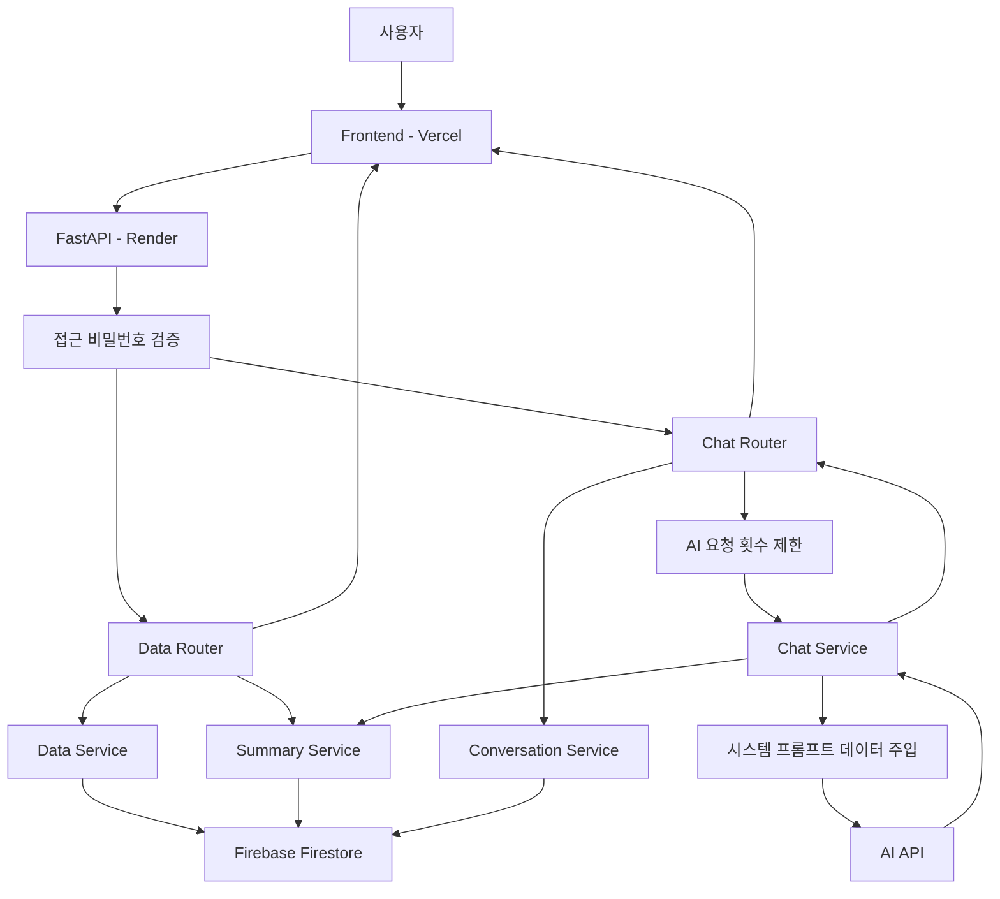
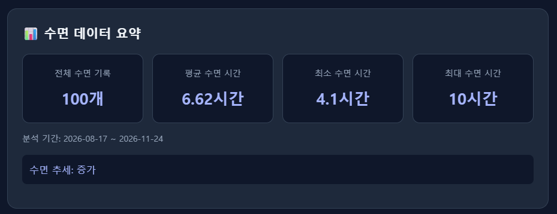
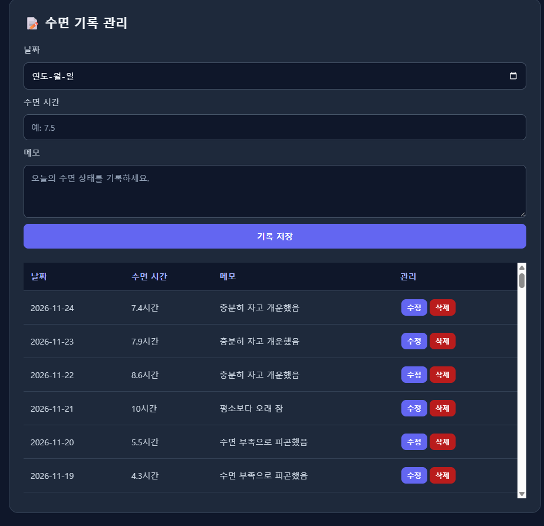

# 🌙 Sleep AI

> 시계열 수면 데이터를 활용한 데이터 기반 AI 챗봇 서비스

## 1. 프로젝트 소개

Sleep AI는 수면 기록 데이터를 기반으로 사용자의 수면 패턴을 분석하고,
AI 챗봇을 통해 수면 통계 및 개선 방향을 안내하는 웹 서비스입니다.

Firebase Firestore에 저장된 수면 데이터를 FastAPI 서버에서 분석하고,
분석 결과를 AI 모델의 시스템 프롬프트에 주입하여
실제 데이터에 근거한 답변을 생성합니다.

본 프로젝트는 교육용 프로젝트이며,
가상의 시계열 수면 데이터 100개를 사용합니다.

## 2. 배포 주소

- 웹사이트: https://my-ai-chatbot-frontend-eight.vercel.app
- 백엔드: https://sleep-ai-backend.onrender.com
- API 문서: https://sleep-ai-backend.onrender.com/docs
- GitHub: https://github.com/jmyd051027/my-ai-chatbot

서비스 이용 시 설정된 접근 비밀번호가 필요합니다.
접근 비밀번호는 공개 저장소에 게시하지 않습니다.

Render 무료 서버의 첫 접속은 1분 이상 걸릴 수 있습니다.

## 3. 주요 기능

### 수면 데이터 관리

- 가상의 시계열 수면 데이터 100개 저장
- 수면 기록 등록, 조회, 수정, 삭제(CRUD)
- 전체 데이터 개수 및 분석 기간 확인
- 평균, 최소, 최대 수면 시간 분석
- 최근 수면 시간 변화 및 추세 분석

### AI 챗봇

- 수면 통계 기반 AI 답변 생성
- 시스템 프롬프트를 활용한 컨텍스트 주입
- 사용자 질문 및 AI 답변 자동 저장
- 이전 대화 기록 목록 조회
- 이전 대화 내용 불러오기

### 사용자 편의 기능

- AI 답변 생성 중 로딩 메시지 표시
- 답변 생성 중 중복 질문 전송 방지
- 무료 서버 콜드스타트 안내
- API 오류 및 요청 제한 초과 안내

### 보안 및 비용 관리

- 서비스 접근 비밀번호 인증
- 환경변수를 통한 인증 정보 관리
- CORS를 통한 허용 출처 설정
- AI 요청 횟수 제한
- AI 답변 생성 토큰 제한

## 4. 기술 스택

| 구분 | 사용 기술 |
| --- | --- |
| Frontend | HTML, CSS, Vanilla JavaScript |
| Backend | Python, FastAPI |
| Database | Firebase Firestore |
| AI | OpenAI SDK, Codyssey OpenAI 호환 API |
| AI Model | gpt-5-mini |
| 데이터 검증 | Pydantic |
| 환경변수 관리 | python-dotenv |
| 프론트엔드 설정 생성 | Node.js |
| 버전 관리 | Git, GitHub |
| 백엔드 배포 | Render |
| 프론트엔드 배포 | Vercel |

## 5. 시스템 구조



### AI 질문 처리 과정

1. 사용자가 프론트엔드에서 질문을 입력합니다.
2. FastAPI 백엔드가 접근 비밀번호를 검증합니다.
3. AI 요청 횟수 제한을 확인합니다.
4. Firestore에서 수면 기록을 조회합니다.
5. 데이터 개수, 기간, 평균, 최소, 최대, 추세를 계산합니다.
6. 분석 결과를 AI 시스템 프롬프트에 주입합니다.
7. 사용자 질문과 시스템 프롬프트를 AI API에 전달합니다.
8. AI 모델이 데이터에 근거한 답변을 생성합니다.
9. 질문과 답변을 Firestore에 자동 저장합니다.
10. 프론트엔드에 AI 답변을 표시합니다.

## 6. 프로젝트 폴더 구조

```text
my-ai-chatbot/
├── frontend/
│   ├── index.html
│   ├── style.css
│   ├── app.js
│   ├── build.mjs
│   └── vercel.json
├── routers/
│   ├── data_router.py
│   └── chat_router.py
├── schemas/
│   ├── data.py
│   └── chat.py
├── services/
│   ├── data_service.py
│   ├── summary_service.py
│   ├── chat_service.py
│   └── conversation_service.py
├── security/
│   └── auth.py
├── scripts/
│   └── seed_data.py
├── screenshots/
│   ├── dashboard.png
│   ├── chat.png
│   ├── data.png
│   └── history.png
├── database.py
├── main.py
├── requirements.txt
├── .env.example
├── .gitignore
└── README.md
```

### 주요 파일 및 폴더 역할

| 파일 또는 폴더 | 역할 |
| --- | --- |
| main.py | FastAPI 앱 실행, CORS 및 라우터 등록 |
| database.py | Firebase 인증 및 Firestore 연결 |
| routers/ | API 요청 처리 및 응답 반환 |
| schemas/ | Pydantic을 활용한 요청 및 응답 데이터 검증 |
| services/ | 데이터 처리, 통계 분석, AI 호출 및 대화 저장 |
| security/ | 서비스 접근 비밀번호 검증 |
| scripts/ | 초기 테스트 데이터 생성 |
| frontend/ | 사용자 화면 및 API 통신 |
| build.mjs | 환경변수를 읽어 프론트엔드 설정 파일 생성 |
| vercel.json | Vercel 빌드 설정 |
| screenshots/ | 주요 기능 실행 화면 |

프론트엔드의 config.js는 빌드 과정에서 자동 생성되며,
GitHub 저장소에는 포함하지 않습니다.

## 7. 데이터베이스 구조

Firebase Firestore의 data 및 conversations 컬렉션을 사용합니다.

### data 컬렉션

날짜별 수면 기록을 저장합니다.

| 필드 | 자료형 | 설명 |
| --- | --- | --- |
| date | String | 수면 기록 날짜 |
| value | Number | 수면 시간 |
| memo | String | 수면 상태 메모 |

데이터 예시:

```json
{
  "date": "2026-11-24",
  "value": 7.5,
  "memo": "수면 기록 예시"
}
```

수면 데이터는 날짜에 따라 기록되는 시계열 데이터입니다.

Pydantic을 활용하여 날짜 형식, 수면 시간 범위(0~24시간),
메모 길이 등의 입력값을 검증합니다.

### conversations 컬렉션

사용자의 질문과 AI 답변을 저장합니다.

| 필드 | 자료형 | 설명 |
| --- | --- | --- |
| question | String | 사용자 질문 |
| answer | String | AI 답변 |
| created_at | String | 대화 생성 시간 |

각 데이터와 대화는 Firestore 문서 ID로 구분합니다.

## 8. API 명세

| Method | Endpoint | 설명 |
| --- | --- | --- |
| GET | / | 서버 상태 확인 |
| POST | /api/data | 수면 기록 등록 |
| GET | /api/data | 전체 수면 기록 조회 |
| PUT | /api/data/{data_id} | 수면 기록 수정 |
| DELETE | /api/data/{data_id} | 수면 기록 삭제 |
| GET | /api/data/summary | 수면 통계 및 추세 조회 |
| POST | /api/chat | AI 질문 및 답변 저장 |
| GET | /api/conversations | 이전 대화 목록 조회 |
| GET | /api/conversations/{conversation_id} | 특정 대화 조회 |

모든 /api 경로에는 X-Access-Key 헤더를 통한
접근 인증이 필요합니다.

### 주요 HTTP 상태 코드

| 상태 코드 | 의미 |
| --- | --- |
| 200 | 요청 성공 |
| 201 | 데이터 생성 성공 |
| 401 | 접근 비밀번호 인증 실패 |
| 404 | 요청한 데이터 또는 대화 없음 |
| 422 | 입력 데이터 검증 실패 |
| 429 | AI 요청 횟수 제한 초과 |
| 500 | 서버 내부 처리 오류 |
| 503 | 서버 인증 설정 오류 |

FastAPI의 Swagger UI를 통해 API 명세를 확인할 수 있습니다.

## 9. 환경변수 설정

프로젝트 최상위 경로에 .env 파일을 생성합니다.

.env.example 파일을 참고하여 필요한 값을 설정합니다.

```env
OPENAI_API_KEY=
OPENAI_BASE_URL=https://copa.codyssey.kr/v1
OPENAI_MODEL=gpt-5-mini

FIREBASE_SERVICE_ACCOUNT_PATH=firebase-key.json
FIREBASE_SERVICE_ACCOUNT_JSON=

API_BASE_URL=http://127.0.0.1:8000
ALLOWED_ORIGINS=http://localhost:5500,http://127.0.0.1:5500

APP_ACCESS_KEY=
```

| 환경변수 | 설명 |
| --- | --- |
| OPENAI_API_KEY | AI API 인증 키 |
| OPENAI_BASE_URL | OpenAI 호환 API 서버 주소 |
| OPENAI_MODEL | 사용할 AI 모델 |
| FIREBASE_SERVICE_ACCOUNT_PATH | 로컬 Firebase 인증 파일 경로 |
| FIREBASE_SERVICE_ACCOUNT_JSON | 배포용 Firebase 인증 JSON |
| API_BASE_URL | 프론트엔드 빌드에 사용할 백엔드 주소 |
| ALLOWED_ORIGINS | 접속을 허용할 프론트엔드 주소 |
| APP_ACCESS_KEY | 서비스 접근 비밀번호 |

실제 API 키, Firebase 인증 정보 및 접근 비밀번호는
GitHub에 업로드하지 않습니다.

## 10. 로컬 실행 방법

### 사전 준비

- Python
- Node.js
- Git
- Firebase 프로젝트 및 인증 정보
- 사용 권한이 있는 AI API 키

### 10-1. 저장소 다운로드

```powershell
git clone https://github.com/jmyd051027/my-ai-chatbot.git
cd my-ai-chatbot
```

### 10-2. 가상환경 생성 및 활성화 (Windows)

```powershell
python -m venv .venv
.\.venv\Scripts\Activate.ps1
```

### 10-3. 라이브러리 설치

```powershell
pip install -r requirements.txt
```

### 10-4. 환경변수 설정

```powershell
Copy-Item .env.example .env
```

생성된 .env 파일에 AI API 키,
Firebase 인증 정보 및 접근 비밀번호를 설정합니다.

로컬 Firebase 인증 파일을 사용하는 경우
프로젝트 최상위 경로에 firebase-key.json을 배치합니다.

### 10-5. 초기 데이터 준비

새로운 Firestore 환경에서 테스트 데이터가 필요한 경우
scripts/seed_data.py를 활용하여 초기 데이터를 생성합니다.

기존 데이터가 있는 운영 환경에서는
중복 데이터 생성 여부를 확인한 후 실행해야 합니다.

### 10-6. 백엔드 실행

프로젝트 최상위 경로에서 다음 명령어를 실행합니다.

```powershell
python -m uvicorn main:app --reload
```

API 문서:

http://127.0.0.1:8000/docs

### 10-7. 프론트엔드 실행

백엔드 터미널은 실행 상태로 유지합니다.

새로운 PowerShell 터미널을 열고
프로젝트 최상위 경로에서 다음 명령어를 실행합니다.

```powershell
$env:API_BASE_URL = "http://127.0.0.1:8000"

Push-Location .\frontend
node build.mjs
Pop-Location

python -m http.server 5500 --directory frontend
```

브라우저에서 다음 주소로 접속합니다.

http://127.0.0.1:5500

Node.js 빌드 스크립트는 PowerShell 환경변수에 설정된
API_BASE_URL을 읽어 frontend/config.js를 생성합니다.

따라서 app.js의 소스코드를 직접 수정할 필요가 없습니다.

### 10-8. 로컬 실행 환경 제한사항

교육기관 PC에서 Pydantic의 네이티브 모듈인
_pydantic_core 실행이 Windows 애플리케이션 제어 정책에
의해 차단되는 문제가 발생했습니다.

이로 인해 해당 PC에서는 FastAPI 서버의
로컬 실행을 완료하지 못했습니다.

교육기관에 관련 문제를 문의한 상태이며,
기관의 보안 정책을 우회하지 않았습니다.

Firestore 연결, 초기 데이터 저장, 통계 분석,
대화 저장 서비스 및 Python 문법 검사는 로컬에서 확인했습니다.

FastAPI API 및 AI 챗봇의 실제 통합 동작은
Render와 Vercel 배포 환경에서 검증했습니다.

## 11. 배포 방법

### 11-1. Render 백엔드 배포

GitHub 저장소를 Render Web Service에 연결합니다.

Build Command:

```bash
pip install -r requirements.txt
```

Start Command:

```bash
uvicorn main:app --host 0.0.0.0 --port $PORT
```

Render 환경변수 설정:

| 환경변수 | 설정 내용 |
| --- | --- |
| OPENAI_API_KEY | 발급받은 AI API 키 |
| OPENAI_BASE_URL | https://copa.codyssey.kr/v1 |
| OPENAI_MODEL | gpt-5-mini |
| FIREBASE_SERVICE_ACCOUNT_JSON | Firebase 서비스 계정 JSON |
| APP_ACCESS_KEY | 서비스 접근 비밀번호 |
| ALLOWED_ORIGINS | https://my-ai-chatbot-frontend-eight.vercel.app |

AI API 서버 주소와 모델은 코드의 기본값으로도 설정되어 있으며,
필요에 따라 환경변수로 변경할 수 있습니다.

### 11-2. Vercel 프론트엔드 배포

GitHub 저장소를 Vercel 프로젝트에 연결합니다.

| 설정 항목 | 설정값 |
| --- | --- |
| Root Directory | frontend |
| Framework Preset | Other |
| Build Command | node build.mjs |
| Output Directory | . |

Vercel 환경변수:

```env
API_BASE_URL=https://sleep-ai-backend.onrender.com
```

빌드 과정에서 build.mjs가 API_BASE_URL 환경변수를 읽어
config.js 파일을 생성합니다.

index.html은 config.js를 app.js보다 먼저 불러오며,
app.js는 window.APP_CONFIG.API_BASE_URL을 사용합니다.

AI API 키와 Firebase 인증 정보는
프론트엔드 환경변수에 등록하지 않습니다.

## 12. 수면 데이터 분석 결과

| 분석 항목 | 결과 |
| --- | --- |
| 전체 수면 기록 | 100개 |
| 분석 시작일 | 2026-08-17 |
| 분석 종료일 | 2026-11-24 |
| 평균 수면 시간 | 6.62시간 |
| 최소 수면 시간 | 4.1시간 |
| 최대 수면 시간 | 10시간 |
| 이전 평균 | 6.64시간 |
| 최근 평균 | 7.06시간 |
| 최근 증가량 | 0.42시간 (약 25분) |
| 수면 추세 | 증가 |

위 결과는 가상의 초기 수면 데이터 100개를 기준으로 합니다.

데이터가 등록, 수정 또는 삭제되면
현재 저장된 데이터를 기준으로 통계를 다시 계산합니다.

## 13. AI 컨텍스트 주입

AI가 일반적인 지식만으로 답변하는 것이 아니라
프로젝트의 실제 수면 통계를 활용하도록 구현했습니다.

### 처리 방식

1. summary_service.py에서 수면 통계를 계산합니다.
2. chat_service.py에서 분석 결과를 JSON 문자열로 변환합니다.
3. 분석 결과를 AI 시스템 프롬프트에 포함합니다.
4. 사용자 질문은 user 메시지로 별도 전달합니다.
5. OpenAI 호환 Chat Completions API를 호출합니다.

메시지 구성 예시:

```python
messages = [
    {
        "role": "system",
        "content": instructions
    },
    {
        "role": "user",
        "content": question
    }
]
```

instructions에는 수면 분석 결과와 AI 답변 지침이 포함됩니다.

AI는 제공된 통계에 근거하여 답변하도록 지시받으며,
데이터에 없는 수치를 임의로 생성하지 않도록 안내합니다.

다만 생성형 AI의 특성상 모든 답변의 정확성을
항상 보장할 수 있는 것은 아닙니다.

### AI 챗봇 사용 예시

사용자 질문:

전체 수면 기록의 개수, 평균 수면 시간,
최저 및 최고 수면 시간, 최근 수면 변화 추세를
분석하고 개선 방법을 추천해 줘.

실제 최종 테스트 답변 요약:

- 전체 수면 기록은 100회입니다.
- 평균 수면 시간은 6.62시간입니다.
- 최저 수면 시간은 4.1시간입니다.
- 최고 수면 시간은 10시간입니다.
- 최근 평균은 7.06시간입니다.
- 이전 평균은 6.64시간입니다.
- 최근 수면 시간이 약 25분 증가했습니다.
- 규칙적인 수면 시간과 취침 전 생활 습관 개선을 권장합니다.
- 가상의 테스트 데이터이며 의학적 진단은 불가능합니다.

최종 배포 환경에서 AI 답변의 주요 수치가
실제 Firestore 기반 통계와 일치함을 확인했습니다.

## 14. 서비스 실행 화면

### 14-1. 수면 데이터 요약



### 14-2. AI 수면 상담


### 14-3. 수면 기록 관리



### 14-4. 이전 대화 기록


## 15. 보안 및 비용 관리

### 15-1. 보안 관리

- API 키와 Firebase 인증 정보는 서버 환경변수로 관리합니다.
- .gitignore를 통해 민감한 인증 파일의 업로드를 방지합니다.
- 접근 비밀번호를 사용하여 API 접근을 제한합니다.
- X-Access-Key 헤더를 통해 접근 비밀번호를 검증합니다.
- CORS 설정으로 허용된 프론트엔드 출처를 관리합니다.
- 접근 비밀번호는 프론트엔드 실행 중 메모리에만 유지합니다.

본 프로젝트의 접근 비밀번호 방식은
교육용 서비스의 간단한 접근 제어를 목적으로 합니다.

### 15-2. AI 비용 관리

| 관리 항목 | 설정 |
| --- | --- |
| 1분당 AI 요청 제한 | 최대 5회 |
| 24시간당 AI 요청 제한 | 최대 30회 |
| 최대 생성 토큰 | 4,000개 |
| 중복 질문 전송 | 답변 생성 중 버튼 비활성화 |
| 요청 제한 초과 | HTTP 429 응답 |
| 제한 초과 안내 | 프론트엔드 오류 메시지 표시 |

AI 요청 횟수 제한은 AI API 호출 전에 검사합니다.

요청 한도를 초과한 경우 AI API를 호출하지 않습니다.

요청 기록은 deque와 Lock을 활용하여
서버 프로세스 메모리에서 관리합니다.

제한은 사용자별이 아닌 서버 프로세스 전체에 적용됩니다.
AI 호출이 실패한 경우에도 허용된 요청은 횟수에 포함됩니다.

서버 재시작 시 요청 횟수 기록이 초기화되므로
영구적인 비용 상한을 보장하는 방식은 아닙니다.

최대 생성 토큰 제한은 입력 토큰을 포함한
전체 사용량의 제한을 의미하지 않습니다.

교육용 API는 제공 기관의 사용 정책과 한도를 준수해야 합니다.

### 15-3. 콜드스타트 대응

Render 무료 서버는 일정 시간 사용하지 않으면
절전 상태로 전환될 수 있습니다.

이 경우 첫 접속 시 응답이 지연될 수 있으므로
사용자에게 다음 안내 메시지를 표시합니다.

> 서버에 접속하고 있습니다. 무료 서버의 첫 접속은
> 1분 이상 걸릴 수 있습니다. 잠시 기다려 주세요.

AI 답변 생성 중에도 로딩 메시지를 표시하고,
중복 질문 전송을 방지합니다.

## 16. 기능 테스트 결과

### 주요 기능 검증

- [x] 접근 비밀번호 인증
- [x] Firebase 데이터 연동
- [x] 수면 데이터 100개 저장
- [x] 데이터 등록
- [x] 데이터 조회
- [x] 데이터 수정
- [x] 데이터 삭제
- [x] 수면 통계 분석
- [x] AI 답변 생성
- [x] 시스템 프롬프트 기반 데이터 주입
- [x] 대화 기록 자동 저장
- [x] 이전 대화 기록 불러오기
- [x] Render 백엔드 배포
- [x] Vercel 프론트엔드 배포
- [x] Vercel 환경변수 기반 API 주소 생성
- [x] AI 요청 제한 함수 테스트
- [x] 최신 배포 환경 AI 답변 검증
- [ ] 실제 배포 서버의 요청 제한 초과 응답 통합 테스트
- [ ] 교육기관 PC의 FastAPI 로컬 실행 검증

### AI 요청 제한 함수 테스트

실제 AI API를 호출하지 않고
요청 제한 함수만 분리하여 테스트했습니다.

```text
=== 1-minute limit test ===
Request 1: ALLOWED
Request 2: ALLOWED
Request 3: ALLOWED
Request 4: ALLOWED
Request 5: ALLOWED
Request 6: BLOCKED (429)

=== 24-hour limit test ===
Daily limit: BLOCKED (429)
```

1분당 5회까지 요청이 허용되고
6번째 요청이 차단되는 것을 확인했습니다.

24시간 요청 한도 초과 시에도
429 오류가 발생하는 것을 확인했습니다.

테스트 과정에서 실제 AI API 호출 비용은 발생하지 않았습니다.

해당 검사는 요청 제한 함수 자체의 테스트이며,
실제 배포 서버의 HTTP 429 응답 및 화면 표시까지
검증한 통합 테스트와는 구분됩니다.

## 17. 프로젝트를 통해 배운 점

### 시계열 데이터

날짜에 따라 기록된 데이터를 활용하여
평균, 최소, 최대 및 시간에 따른 변화 추세를
분석하는 방법을 학습했습니다.

### FastAPI와 REST API

GET, POST, PUT, DELETE 메서드를 활용하여
데이터 CRUD 기능을 구현했습니다.

### Router와 Service 분리

API 요청 처리와 실제 데이터 처리 로직을 분리하여
코드의 가독성과 유지보수성을 높였습니다.

### Pydantic

입력 데이터의 자료형과 범위를 검증하여
잘못된 데이터가 저장되는 것을 방지하는 방법을 학습했습니다.

### Firebase Firestore

컬렉션과 문서 구조를 이해하고,
데이터 생성, 조회, 수정, 삭제 및 대화 저장을 구현했습니다.

### AI 컨텍스트 주입

분석된 데이터를 시스템 프롬프트에 포함하여
AI가 프로젝트의 실제 데이터에 근거한 답변을
생성하도록 구현했습니다.

### CORS 및 환경변수

프론트엔드와 백엔드의 출처가 다른 배포 환경에서
CORS 설정의 필요성을 이해했습니다.

인증 정보와 서버 설정을 소스코드에서 분리하여
환경변수로 관리하는 방법을 학습했습니다.

### Git 및 웹 서비스 배포

Git과 GitHub를 활용한 버전 관리,
Render 백엔드 배포 및 Vercel 프론트엔드 배포를 경험했습니다.

### 오류 분석 및 비용 관리

서버 로그를 활용하여 API 오류를 분석하고,
AI 생성 토큰 및 요청 횟수를 제한하는 방법을 학습했습니다.

## 18. 주의사항

- 본 서비스는 교육용 프로젝트입니다.
- 저장된 수면 기록은 가상의 테스트 데이터입니다.
- 실제 의료 서비스를 제공하지 않습니다.
- 의학적 진단 및 치료를 목적으로 하지 않습니다.
- AI 답변은 참고용이며 오류가 포함될 수 있습니다.
- 실제 API 키와 인증 정보는 공개하지 않습니다.
- 무료 배포 서버의 특성상 첫 접속이 지연될 수 있습니다.

---

**Sleep AI — Data-driven AI Sleep Analysis Chatbot**
